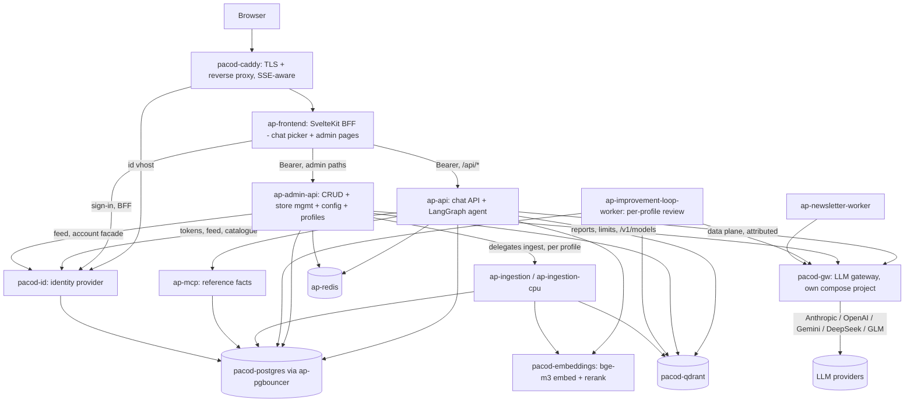
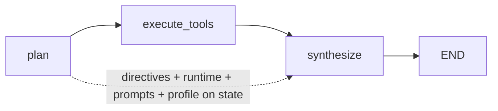
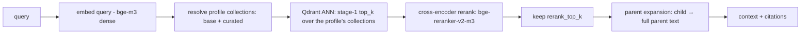
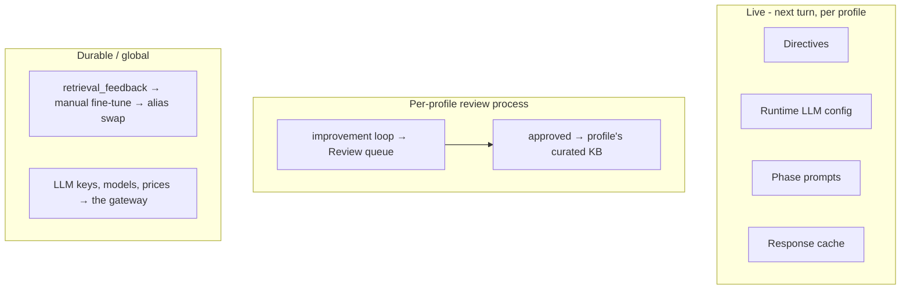

# Architecture

This document describes the architecture, solution design, and implementation of **pacod** — a
**multi-profile AI agent platform**. A single deployment hosts many self-contained **profiles**
(agents), each with its own knowledge base, reference facts, prompts, directives, runtime config,
cache, conversations, and reviews. The default profile is **`starter`**, a generic template agent (the
help desk of a fictional note-taking service) that exercises every platform feature; the **Bulgarian
tax & accounting agent** (`taxes`) is an advanced example installed on demand. The same machinery hosts
any number of dedicated agents side by side. Two sibling services complete the platform:
**pacod-gw**, the LLM gateway, and **pacod-id**, the identity provider.

It complements two other docs:
- [`README.md`](README.md) — quick start, learning loop, admin examples.
- [`CLAUDE.md`](CLAUDE.md) — the developer reference (exhaustive file/route/setting index).

This file is the *narrative* counterpart: why the system is shaped the way it is, how the pieces fit,
and how a request flows end to end.

---

## 1. Purpose & scope

pacod is a platform for **retrieval-augmented, tool-using consultants**. Each profile's job is to
give correct, sourced answers in its domain while refusing to assist with anything illegal.
Correctness in such domains is unforgiving — a wrong price, rate or due date is worse than no answer —
so the system is built so that **every number comes from a structured source of truth**, every claim
cites a document, and admins can correct any agent without a redeploy.

The **multi-profile** dimension is the defining structural property: users are *assigned* profiles
and see only theirs; admins either work globally (all profiles) or scope every view to one profile;
and — critically — a turn against profile A can only ever reach profile A's data. Profile isolation
is a **security boundary**, not a convenience feature.

### Core requirements that shaped the design

| Requirement | Architectural consequence |
|---|---|
| Many independent agents on one deployment | A `profiles` table anchors everything; every domain/telemetry table carries a `profile_id`; each profile has its own Qdrant collections, reference facts, prompts, directives, config, and cache. |
| A user must never reach a profile they aren't assigned | The requested `profile_id` is validated against `user_profiles` **before any work**; MCP tool args are set programmatically (never by the planner LLM); `/v1/models` is filtered per user. |
| Numbers must never be hallucinated | Reference facts live in Postgres (`reference_facts`), served via MCP tools scoped to the profile; those tools are the *authoritative* source for numbers. A number the user explicitly asks for is additionally **cross-verified** against the KB/web (the fact wins, a conflict is surfaced). |
| Answers must be sourced | KB retrieval emits citations; facts cite their `source_url`; web search is domain-allowlisted. |
| Languages and topic per profile | The platform's languages are configuration (`PLATFORM_LANGUAGES`); language is detected per turn; each profile owns its topic, reference year, and languages. |
| Low latency, streaming UX | The whole turn is `async`; the answer is streamed token-by-token over SSE. |
| Admin correction without redeploy | A per-profile runtime-config layer (`app_settings` + Redis cache) overrides env defaults live. |
| Provider/model flexibility | All LLM calls go through the pacod-gw gateway, which owns providers, credentials, models and prices; the active model per role is runtime-switchable per profile. |
| No home-grown security primitives | Accounts, passwords, sessions and roles are pacod-id's; the app verifies its tokens and follows its feed. |
| Safety | An absolute illegal-request restriction sits at the top of the planner and synthesizer prompts, above even admin directives. |
| Operability | Per-request audit, opt-in per-step debug logging, and gateway-side accounting of every LLM call — all attributable per profile, site, user and turn. |

---

## 2. Design principles

1. **Profiles are isolated.** Every profile-scoped read/write carries a `profile_id`. A turn resolves
   and *authorizes* its profile before doing anything, then that profile rides on the agent state and
   scopes retrieval, structured data, config, cache, and every telemetry write. Isolation is enforced
   in code, never left to the client.
2. **One source of truth per fact type.** Reference facts → Postgres (MCP). Explanatory text →
   Qdrant KB. Recency → web search. The planner picks sources by *kind of claim*, not convenience.
3. **All LLM traffic goes through the gateway.** No provider SDK is called directly. pacod-gw owns
   providers, credentials, the model list, prices and the record of every call; the app owns request
   parameters and **attributes** every call (user, session, turn, profile, purpose, site, variant), so
   the gateway's reports can answer the app's questions.
4. **One retry layer, and timeouts are never retried.** The client is the only layer that retries
   (`x-gw-retries: 1` switches the gateway's off), every failure maps to exactly one error class with a
   `retryable` flag, and a timed-out call is never re-sent — the provider bills it anyway.
5. **Identity is delegated.** pacod-id holds accounts, sessions and role bindings; the app verifies
   tokens, derives roles from permissions, keeps a local shadow row per person, and routes every
   account change to pacod-id *as the calling admin*, so escalation rules are enforced in one place.
6. **Guards before the stream opens.** Auth, profile authorization, language, quota, and topic checks
   run *before* the SSE response begins, so rejections return proper HTTP status codes instead of
   mid-stream errors.
7. **Runtime config overrides env defaults, per profile.** A uniform pattern (`app_settings` row →
   Redis cache → env default) makes models, params, web search, directives, prompts, cache, and the
   review process changeable live — keyed by `(profile_id, key)`. `get_settings()` stays a
   startup-cached singleton only for what is genuinely fixed.
8. **Shared core, separate processes.** `ap-api` and `ap-admin-api` are different containers but import the
   same `app.core.*` / `app.guards.*` — no logic duplication, strong process isolation.
9. **Fire-and-forget side effects, fail-soft dependencies.** Audit, usage, and debug writes never raise
   into the request path; an unreachable gateway report or quota never blocks a page or a turn.
10. **Brace-safe, injection-safe prompt assembly.** Admin/user text is always interpolated as a
   *value*, never into a format string; the illegal-request restriction is non-overridable.

---

## 3. System context (containers)



| Container | Role | Notes |
|---|---|---|
| `pacod-caddy` | TLS termination, reverse proxy, SSE buffering off | The only public edge (pacod-ap's site: `platform/caddy/ap.caddy`): the app, pacod-id's issuer and the gateway console each have a vhost; routes `/api/*` to the SvelteKit `ap-frontend`. |
| `ap-frontend` | SvelteKit BFF (chat + admin) | Signs people in at pacod-id as the confidential client `pacod-web`, keeps the tokens server-side, sends the access token as the Bearer, and proxies admin paths to `ap-admin-api`, everything else to `ap-api`. Hosts the per-user chat profile picker and the admin global/profile scope selector. |
| `ap-api` | Chat API + agent runtime | The heart of the system (`app.main:app`); runs the schema pass, seeds the default profile, pushes the app's role catalogue to pacod-id and erases deleted accounts. |
| `ap-admin-api` | Control plane | CRUD, store management, KB curation, per-profile runtime config, **profile CRUD + user↔profile assignment**, and the facades over pacod-id (accounts, roles) and the gateway (reports, the users' token limit). |
| `ap-ingestion` / `ap-ingestion-cpu` | Document ingestion pipeline over HTTP | Embeddings over HTTP vs in-process CPU bge-m3; writes into the target profile's collections. |
| `ap-mcp` | Reference-fact tools | `get_fact` / `list_facts` over Postgres, filtered by `profile_id`; shared-token guarded. |
| `pacod-embeddings` | bge-m3 embeddings + bge-reranker cross-encoder | Auto-detects GPU; optional ONNX-INT8 reranker for CPU. Shared by all profiles (same 1024-dim space). |
| `pacod-id` (+ `pacod-db-init`) | Identity provider | Accounts, hosted sign-in, sessions, role bindings, service tokens; its own database `pacod_id`, reached directly (not through PgBouncer). |
| pacod-gw (`pacod-gw`, `gw-console`, …) | LLM gateway | A separate compose project (`pacod-ap-gw`, pacod-gw's app file only) on the shared `pacod-net` network: providers, credentials, models, prices, limits, usage reports, its own metrics. |
| `ap-improvement-loop-worker` | Always-on review engine | Drains the `loop_run_requests` queue and runs the per-profile continuous-improvement loop; fires the daily prunes. |
| `ap-newsletter-worker` | Always-on newsletter engine | Per-profile collect/send queue + calendar schedules. |
| `pacod-postgres` (+ `ap-pgbouncer`) | Relational source of truth | PostgreSQL 18.6: the app (`pacod`), pacod-id (`pacod_id`). |
| `ap-redis` | Cache + rate limiting | Request quota + throttle, topic cache, per-profile config/response caches, the frontend's sessions. |
| `pacod-qdrant` | Vector store | One base + `_parents` + curated collection **per profile**; 1024-dim bge-m3 dense, cosine. |

Names follow the shared convention (pacod-demo/docs/NETWORK.md): `pacod-*` for the shared
components (`pacod-caddy`, `pacod-postgres`, `pacod-qdrant`, `pacod-embeddings`, `pacod-id`), `ap-*`
for pacod-ap's own; service key = container name = DNS name on the one network `pacod-net`.
`docker-compose.yml` (the app file) holds the `ap-*` services and `pacod-embeddings`;
`docker-compose.standalone.yml` holds pacod-ap's copies of the other shared components.

The repo root holds `pacod-api/` (this directory), `pacod-ui/` (SvelteKit), `monitoring/`, `deploy/`,
`platform/` (pacod-ap's Caddy, PostgreSQL and Prometheus fragments) and `scripts/`; the gateway is a
sibling checkout (`../pacod-gw`).

---

## 4. The multi-profile model

A **profile** is a self-contained agent. Everything that makes an agent distinct — its knowledge
base, reference facts, prompts, directives, model choices, cache, and history — is scoped to it.

### 4.1 Anchor tables

- **`profiles`** — one row per agent: `id`, `slug`, `name`, `description`, `topic_name` +
  `topic_description_bg/en` (topic-guard gating), `legal_year` (the reference year), `languages`
  (CSV), the stored `base_collection` / `curated_collection` Qdrant names, `is_active`, and the agent
  editor's `release_state` + version pointers.
- **`user_profiles`** — a many-to-many assignment (cascade-deletes with the user). It stays local:
  which agents a person may use is the app's decision, not a pacod-id binding. A user may chat with exactly the profiles assigned here; admins/superusers bypass the
  membership check.

Two sentinel ids matter throughout the code (`app/core/db_models.py`):
`DEFAULT_PROFILE_ID = "starter"` (the profile an admin resolves to when none is named; seeded at boot
from settings) and `GLOBAL_PROFILE_ID = "__global__"` (the `app_settings` row-space for genuinely
platform-wide settings — the capture and quota toggles, the quota settings, the editor assistant's
config, the workers' day guards).

### 4.2 What is per-profile vs global

| Per-profile (`profile_id` column / key) | Global (shared infra) |
|---|---|
| `reference_facts`, `agent_directives`, `ingested_sources` | `users` (the shadow of pacod-id accounts), `user_ip_addresses`, `user_activity` |
| `audit_log`, `usage_events` (web search), `debug_interactions`, `retrieval_traces`, `turn_evidence`, `llm_call_errors` | `llm_templates`, `provider_secrets` (search keys) |
| `retrieval_feedback`, `response_feedback`, `deleted_chat_sessions` | `crawler_visits`, `web_requests`, `page_views` (the `site` axis) |
| `loop_runs`, `loop_run_requests`, `loop_findings`, `loop_clusters`, `loop_fix_checks`, `kb_candidates`, `golden_tests` | The embeddings service (one shared 1024-dim space) |
| `newsletter_*`, `agent_definitions`, `agent_versions`, `agent_deployments` | pacod-gw: providers, credentials, models, prices, limits, the LLM usage record |
| `app_settings` (composite PK `(profile_id, key)`): `agent.*`, `websearch.*`, `respcache.*`, `prompt.*`, `loop.*`, `newsletter.*`, `active_collection` | `app_settings` under `__global__`: `debug_audit_enabled`, `turn_evidence_enabled`, `quota_enforcement_enabled`, `quota.*`, `editor_assistant.*` |
| Qdrant collections: `pacod_<slug>_kb`, `pacod_<slug>_kb_parents`, `pacod_<slug>_curated` | pacod-id: accounts, sessions, role bindings |

Quotas are enforced **per user total** (not per profile), but usage is *reported* per profile. Models,
prices and provider keys are the gateway's; the per-role *model selection* is per profile.

### 4.3 Profile resolution & the authorization boundary

The single most important isolation rule lives in `app/services/profiles.py :: resolve_profile_id`,
called right after authentication on every chat/feedback/OpenAI-compat request:

- If the request names a `profile_id`: a **non-admin** must have it in `user_profiles` and it must be
  released (else **403**); admins may target any active profile, in either agent-editor variant.
- If no `profile_id` is given: a non-admin resolves to their *sole* visible assignment (0 or 2+ → 403 —
  never silently fall back to a profile they aren't assigned to); admins get the default profile.

The result is a `ProfileContext` (id, slug, legal_year, topic, collections) that rides on the agent
state. Three further isolation guarantees back this up:

1. **MCP tool args are injected programmatically** (`app/tools/reference_facts.py`, called from
   `graph._execute_one_tool`) — `profile_id` and the reference year are never exposed to or filled by
   the planner LLM, so it cannot omit or forge them.
2. **`GET /v1/models`** (OpenAI-compat) is filtered to the caller's assigned profiles — each profile
   is exposed as one "model" (its slug) — and every completion is authorized as its caller against
   their assignments, so a user can't reach an unassigned profile through it.
3. **Every per-profile Redis cache key and cache bucket carries the `profile_id`** — config,
   directives, topic classification, response cache, conversation summaries and stats keys are all
   namespaced, so no profile can read another's cached state. (Global config, per-user quota counters
   and the query-embedding cache are not per profile by design.)

### 4.4 Admin scoping: global vs one profile

The admin console works in two modes via a `selectedProfile` store fed by a topbar selector:
- **Global** (no profile selected) — every admin list shows all profiles' data; usage analytics
  aggregate across profiles with an optional per-profile filter.
- **Scoped** — a `profile_id` query param threads into every admin list/config call, so the view (and
  edits, and creates) apply to exactly one profile.

Profiles are created by **superusers** (creation provisions the profile's Qdrant collections; deletion
tears them down and cascade-removes every scoped row) and assigned to users by **admins**. A new
person gets every released agent on their first request (`assign_all_active_profiles`).

### 4.5 Languages

The pipeline knows two languages (`bg`, `en` — prompts, guard messages, detection). A deployment
chooses which it offers (`PLATFORM_LANGUAGES`) and its fallback (`PLATFORM_DEFAULT_LANGUAGE`); the api
refuses to boot on an unknown code. Each profile narrows the set with its own `languages`, enforced
per turn. A third language is a code change (a new `Language` member and its prompts), not
configuration.

---

## 5. The chat request lifecycle

A chat turn is the central flow, split into a **guard phase** (synchronous, before any bytes stream)
and a **streaming phase** (SSE). Source: `app/api/routes_chat.py`, `app/api/turn_pipeline.py`,
`app/agent/graph.py`.

```mermaid
sequenceDiagram
    participant C as Client (via the BFF)
    participant API as api (routes_chat)
    participant G as Guards
    participant R as AgentRunner (graph)
    participant T as Tools
    participant L as pacod-gw

    C->>API: POST /api/v1/chat (Bearer pacod-id token; message, session_id, profile_id?, history)
    API->>G: AuthGuard → resolve+authorize profile → effective agent → LanguageGuard → QuotaGuard → topic gate
    alt rejected
        G-->>C: HTTP 4xx/503 (auth / profile_forbidden / not_released / language / quota / off-topic)
    else accepted
        Note over API: open SSE stream
        opt first-turn cache hit
            API-->>C: SSE cached citations + token + suggestions (skip agent)
        end
        API->>API: on a miss: load directives + compact history (per profile, Redis-cached)
        API->>R: plan(message, language, year, directives, runtime, prompts, profile)
        R->>L: planner JSON → {is_complex, tool_calls} (attributed: user, session, trace = turn)
        API-->>C: SSE tool_call(s)
        R->>T: execute_tools (asyncio.gather: kb_search / get_fact·list_facts (profile, year) / web_search)
        API-->>C: SSE citation(s)
        R->>L: stream_synthesis (extended thinking if complex; native web search where allowed)
        L-->>API: tokens (+ cost)
        API-->>C: SSE token(s)
        R->>L: generate_suggestions (fast model)
        API-->>C: SSE suggestions
        API->>API: cache store, then web-search usage + quota + audit (incl. every emitted citation) + activity + turn evidence (fire-and-forget, all profile-scoped)
        API-->>C: SSE done {turn_id, usage, quota}
    end
```

### Guard phase (before the stream)

Run in order so HTTP error codes propagate cleanly:

1. **AuthGuard** (`app/guards/auth.py`) — validates the Bearer token → `AuthenticatedUser`: a pacod-id
   access token (issuer + audience `pacod-api`, then the feed copy refuses an ended session or a
   disabled account), a `pidt_` service token, or `dev-token-*` when both development locks are open.
   401 on failure, 503 when pacod-id cannot be asked.
2. **Profile resolution/authorization** — `resolve_profile_id` (§4.3) yields the `ProfileContext` or
   403 (`profile_forbidden`); `resolve_turn_agent` then resolves the effective config for the variant
   (409 when a never-released agent has no deployment). The profile's `legal_year` becomes the turn's
   default reference year.
3. **LanguageGuard** (`app/guards/language.py`) — `lingua` detects the language, with a
   history-inference fallback for short/ambiguous text; the profile's `languages` are then enforced.
4. **QuotaGuard** (`app/guards/quota.py`) — the gateway's advisory per-user token limit (read before the
   turn; fails open), plus the Redis request quota and per-minute throttle. 429 on exceed.
5. **Topic gate** (`app/guards/topic.py`) — a deterministic illegal-phrase filter, then an LLM
   classifier (cheap model) that decides relevance and whether the question needs clarification;
   result cached 24h per profile namespace. Illegal → 403, off-topic → 400, "needs clarification"
   streams clarifying questions and skips the agent.

A **usage scope** (`UsageAccumulator`, ContextVar) tallies token spend per purpose for the turn's own
total, and a **debug scope** (carrying the profile id) records every step when enabled. Both feed the
gateway attribution block as well, so each call is tagged with the user, session, turn, profile, site
and purpose.

### Streaming phase

Directives, the runtime config, the effective prompts, and the response-cache config are resolved
**once per turn** (all Redis-cached, all keyed by the profile) and threaded into the agent. The
client-supplied `history` is also **compacted** here (`turn_pipeline.load_turn_context` →
`conversation_memory.compact()`, shared by both chat paths): recent turn-pairs are kept verbatim and
older ones fold into a per-`(profile, session)` rolling summary in Redis, so multi-turn context reaches
the planner and synthesizer without re-sending the whole transcript (see §6.5). On a first-turn question
the **semantic response cache** (per-profile bucket) may serve a cached answer and skip the agent
entirely. Otherwise the runner drives the LangGraph state machine and streams events: `tool_call`,
`citation`, `thinking`, `token`, `suggestions`, and a final `done`. The OpenAI-compatible endpoint
(`routes_openai_compat.py`) runs the *same* guard chain, turn pipeline and runner, maps `req.model →
profile`, and emits the OpenAI wire format (it does not use the response cache).

---

## 6. The agent (LangGraph)

`app/agent/graph.py` defines a deliberately small `StateGraph` with three nodes. The streaming of the
final answer happens *outside* the graph (in `AgentRunner.stream_synthesis`) so the API can flush
tokens in real time.



| Node | Input | Output |
|---|---|---|
| `plan` | user message, language, year, directives, runtime, prompts, profile | LLM JSON → `tool_calls`, `is_complex` |
| `execute_tools` | `tool_calls` | `asyncio.gather` over tools → `tool_results` |
| `synthesize` | `tool_results` | assembled `context` string + `citations` |

**State threading.** Five per-turn objects ride on `AgentState` from `plan` through synthesis:
- `directives` — aggregated admin high-priority instructions (for this profile).
- `runtime` — the active `AgentRuntimeConfig` (models per role, params, web-search config).
- `prompts` — the effective per-phase prompts (superuser overrides → code defaults).
- `profile` — the `ProfileContext` (id, slug, legal_year, topic, base/curated collections).
- `compacted_history` — the multi-turn conversation memory (verbatim recent turns + rolling summary).

Nodes read models/params from `state["runtime"]` and collections/ids from `state["profile"]`, never
from the settings singleton, so a live config change or a different profile takes effect on the very
next turn. Safe env fallbacks (`env_runtime_config()`, `env_profile_context()`) are used when nothing
is threaded (tests, non-chat callers).

### Planning

`plan_node` calls the **planner role** (`runtime.call("planner")`: its LLM template's model if one is
assigned, else `planner_model`, else the primary model) with a JSON
prompt. Planner rules: numbers, prices, rates, limits and dates come **only** from the reference-fact
tools (`get_fact` / `list_facts`); KB search for explanatory content; web search, together with KB
search, for recent or time-sensitive information; `is_complex = true` enables extended thinking. The
tool list in the prompt is the agent's allowed tools (`[[TOOLS]]`). The planner is told the reference
year, but it can never *set* it or `profile_id` as a tool argument — both are injected by the code.

### Tool execution

`execute_tools_node` runs all planned tool calls concurrently via `asyncio.gather`. `_execute_one_tool`
reads `state["profile"]` and threads it in: `kb_search` gets the `ProfileContext` (so it searches the
profile's collections); `get_fact` / `list_facts` get `profile_id=profile.id` and the turn's
reference year (injected programmatically); `web_search` applies the per-turn web config — or, in
native mode on a model that can enforce the allowlist, moves into the synthesis call itself.

### Synthesis

`synthesize_node` assembles a single `context` string (KB passages, the fact results as JSON under
`### Reference facts`, web results) and de-duplicated `citations` (a fact cites its `source_url`).
`AgentRunner.stream_synthesis` builds the synthesizer system prompt (role + absolute restriction +
directives + rules as the **cacheable prefix**, tool context as the **dynamic suffix**) and streams
the answer from the **primary model**, with extended thinking on complex turns. An **optional verifier**
(`AGENT_VERIFICATION_ENABLED`, off by default) runs a second pass that fact-checks numbers/claims
against the tool context, honoring directives so it never reverts an intentional admin override.

### Prompts

Each profile's prompts — topic classifier, planner, synthesizer BG/EN, verifier BG/EN, suggestions
BG/EN, summarizer BG/EN, the eight loop prompts and the newsletter classifier — are
**runtime-editable per profile**
(`app/services/agent_prompts.py`): a code registry (`PROMPT_SPECS`) is the source of truth; only
overrides are stored as `app_settings` rows keyed `prompt.<key>` under the profile. Two brace-safety
layers protect the editable templates (write-time 422 validation + read-time silent fallback to the
code default). The code defaults are generic; a domain agent's wording is a set of overrides written
by its seed spec (the tax example's `scripts/profiles/taxes_prompts.py`). The planner and synthesizer
open with an **absolute restriction** refusing illegal requests, above even admin directives.

### Conversation memory (§6.5)

`app/services/conversation_memory.py` turns a stateless request into a stateful conversation without
resending the whole transcript each turn. `compact()` normalises the client-supplied `history` (merges
same-role runs, drops a leading assistant turn so Gemini doesn't 400), keeps the **last few
turn-pairs verbatim**, and folds everything older into a **rolling summary** cached per
`(profile, session)` in Redis (`convsummary:{profile}:{session}`), refreshed by a cheap summariser model
every few turns. The verbatim turns are inserted into `LLMClient._build_messages` **after** the cached
system prefix (preserving the prompt-cache breakpoint) and before the current user turn; the summary
rides in the synthesizer's dynamic (uncached) suffix. It is on by default and per-profile
runtime-tunable, and admins can inspect exactly what a turn saw via the Debug Console and manage the
summaries from the Redis admin page.

---

## 7. Retrieval architecture (RAG)

Knowledge-base retrieval is a **two-stage pipeline** (`app/tools/kb_retrieval.py`), scoped to the
turn's profile:



- **Profile-aware collection resolution.** `KBRetriever.retrieve(..., profile)` resolves the base
  collection via a per-profile `get_active_collection` (honoring an admin fine-tune alias override,
  defaulting to the profile's stored `base_collection`) and searches the profile's own curated tier.
  Every profile follows one naming convention — base `pacod_<slug>_kb`, curated `pacod_<slug>_curated`
  — provisioned at creation; the default profile `starter` is `pacod_starter_kb` /
  `pacod_starter_curated`, env-configurable via `RETRIEVAL_COLLECTION_NAME` / `CURATED_COLLECTION_NAME`.
  The names are stored on the profile row, not derived, so a row keeps pointing at whatever physical
  collection holds its data.
- **Stage 1 — ANN recall.** The query is embedded (bge-m3 dense, 1024-dim, cosine); Qdrant returns
  `RETRIEVAL_STAGE1_TOP_K` candidates, filtered by `legal_year`. Query embeddings are Redis-cached.
- **Stage 2 — cross-encoder precision.** A `bge-reranker-v2-m3` cross-encoder rescores; the top
  `RETRIEVAL_RERANK_TOP_K` are kept. Latency knobs: `RETRIEVAL_RERANK_INPUT_K` caps how many are
  reranked, and `RETRIEVAL_RERANK_SCORE_THRESHOLD` can early-exit on high dense confidence.
- **Curated tier.** Each profile has a separate, down-weighted curated collection searched alongside
  the authoritative tier. It holds LLM-synthesised notes, admin-promoted Q&A, and **hand-authored
  knowledge** — see *Curated knowledge as managed content* below.
- **Parent-child expansion.** Hierarchically-ingested PDFs store small child chunks for precise
  matching but expand to the full parent text for synthesis.
- **Retrieval traces.** When enabled, one `retrieval_traces` row per `kb_search` records dense/rerank
  scores + which chunks were used — the prerequisite the review process uses to tell a retrieval
  failure from a content gap. Traces carry the `profile_id`.

### The embeddings service

`embeddings_service/server.py` is a standalone FastAPI service with backends selected by
`EMBEDDINGS_BACKEND`: `bge` (bge-m3 + bge-reranker via FlagEmbedding) and `hash` (deterministic, CI).
It is **shared by all profiles** — every collection lives in the same 1024-dim space, so profiles are
same-dimension by construction. The reranker can additionally run as ONNX-Runtime INT8 on the CPU
path; the bi-encoder stays a reloadable FlagEmbedding model so the (manual) fine-tune's `/reload`
hot-swap keeps working.

### Ingestion

`ingestion_api/` wraps the pipeline (`ingestion/pipeline.py`): chunk → embed (batched) → Qdrant
upsert, writing one `ingested_sources` row per document **stamped with `profile_id`**. Each ingest
request (file/url/text) carries a `profile_id`; the service resolves that profile's collections and
upserts there. Packaged sources come from `data/profiles/<id>/`. PDFs use hierarchical parent-child
ingest on the HTTP-embeddings path (the indexer targets the
profile's collection); the CPU path uses a flat in-process pipeline. Admin upload/url/text requests
are **delegated** from `ap-admin-api` to the `ap-ingestion` service over HTTP (forwarding the profile_id) —
`ap-admin-api` never runs the pipeline in-process. `/drop` is scoped to a profile.

### Curated knowledge as managed content

The curated tier is *content an operator owns*, not a write-only sink the loop appends to. Two columns
on `ingested_sources` make it addressable without scanning Qdrant: **`tier`** (`curated` |
`authoritative` — which collection the source lives in) and **`content`** (the authored body, set only
by the free-text ingest path; file/URL sources leave it NULL). That gives a full lifecycle — create by
hand, list, read, rewrite, retire — over the same `/ingest/text` machinery the loop and the
promote-a-Q&A flow already used, so there is exactly one way text reaches the curated collection.

Two invariants are load-bearing and easy to violate:

- **Rewriting must delete before it re-ingests.** `ingest_doc` upserts by a chunk id that is
  deterministic in the chunk *index* and never deletes, so shortening a note leaves its tail chunks
  behind — still in the collection, still carrying the superseded text, still retrievable. The edit
  route therefore deletes the source's vectors from the *currently resolved* collection first; when the
  edit also changes tier, the source moves collections and the **old** one is the one to clean.
- **Retire ≠ delete.** Superseding a note drops its vectors (so retrieval stops seeing it) while the
  row and its authored body survive — matching the never-delete, always-supersede convention the
  curated tier was designed around. Saving the content again re-indexes it.

Reading a body back is best-effort-lossless rather than exact: rows that predate `content` (and every
loop-approved note) are reconstructed from their stored chunks, de-overlapped at paragraph granularity
because chunking carries whole trailing paragraphs forward. The response flags `reconstructed` so the
UI can say so rather than implying a byte-identical original.

---

## 8. Reference facts (MCP)

`mcp_server/server.py` exposes two HTTP tools — `get_fact(fact_key, variant?, legal_year?)` and
`list_facts(category?, query?, legal_year?, limit?)` — over the per-profile Postgres table
`reference_facts`, **filtered by `profile_id`**. This is the **only** sanctioned source of numeric
facts. The `profile_id` and the turn's reference year arrive as tool arguments that the agent sets
programmatically (never the planner LLM), and the SQL adds `WHERE profile_id = …`. Responses are
small, deterministic JSON dumped verbatim into the synthesis context; `list_facts` is capped (200 by
default) and says when it `truncated`, because its output is pasted into the prompt. The tool routes
require a shared secret (`X-MCP-Token`) and fail closed without one — anything on the internal network
could otherwise read any profile's facts.

A fact is typed (`value_type`: number, percent, money, range, date, annual_date, monthly_day, text,
boolean…), has a key, a category, an optional variant and reference year, labels and descriptions in
both languages, a `source_url` the answer cites, and a free `extra` object for domain attributes. That
one shape covers a SaaS help desk's plan prices (`starter`) and a tax agent's rates and due dates
(`taxes`) alike, so adding a domain is data, not schema.

Keeping numbers in a relational table (rather than the KB) makes them auditable, editable per profile
(admin CRUD with JSON import/export), and verifiable by the verifier pass — and it lets the planner
enforce "numbers only from these tools."

---

## 9. LLM gateway & model routing

Every LLM call goes through **pacod-gw**, the platform's gateway: an OpenAI-compatible data plane
(`GATEWAY_URL`/v1, `http://pacod-gw:8080`) run as its own compose project and reached by name on the shared `pacod-net` network. The
gateway owns what used to be scattered over the app — provider credentials, the model repository and
grants, prices, spend and token limits, and the authoritative record of every call (tokens, cost, the
model actually served, errors) with its own metrics and console. `app/services/llm_client.py`
(`LLMClient`) is the single client; it builds messages and streams completions (`chat`, `chat_json`,
`chat_stream`); records per-turn token usage per **purpose** into a ContextVar `UsageAccumulator` (for
the `done` event and the audit row); tracks time-to-first-token; handles extended thinking per model
dialect; drops the `temperature` field for models that reject it; and supports **provider prompt
caching** (`build_cached_system()` emits an Anthropic `cache_control` breakpoint on the static prefix).

**Attribution is what makes the gateway's record the app's record.** Each call carries a `gateway`
object — end user, chat session, the turn id as trace id, the profile as agent, the purpose as task,
and tags `purpose`/`site`/`profile`/`variant` — taken from the ambient request and turn context. The
admin console's usage, analytics and per-turn pages then *ask the gateway* (its reports API, through
`admin_api/services/gateway_reports.py`: allow-listed parameters, the app's dimensions mapped to tags,
a 30 s cache, zeros plus `gateway_error` when it is away) instead of keeping a ledger of their own.
Only what the gateway cannot see stays local: web-search cost, requests, page views, and the app's own
count of failed calls (which includes client timeouts and an unreachable gateway).

**Retries have exactly one owner.** The SDK's retries are off and every request carries
`x-gw-retries: 1`, so the gateway does not retry either. `_classify_error()` maps every failure to one
error class: a timeout (client-side, or the gateway's 504 `upstream_timeout`) is **never** retried —
the provider finishes and bills the answer anyway, and a retry pays twice; a used-up budget (402) and
any other refused request (4xx) are not retried because they would fail identically; only 429 (after
its `Retry-After`), 5xx and connection errors are. The improvement loop's slower backoff obeys the same
`retryable` flag.

**Model routing is per role, per profile.** The agent's roles — primary (synthesis/verifier), classifier
(topic/suggestions), planner, plus suggestions, history summary and newsletter — are each configurable
in each profile's runtime config (directly, or through a named **LLM template**) and passed per call, so
switching a model takes effect on the next turn without a restart. The ids offered are exactly what the
platform's gateway key may call (`GET /v1/models`); keys, models and prices are configured in the
gateway (`../deploy/pacod-gw/platform-config.*.json`, `make gw-bootstrap`), not here.

**The users' token budget is the gateway's too** — an advisory end-user limit the chat guard reads
before each turn (failing open), while the request quota and burst throttle, which count turns rather
than LLM calls, stay in Redis.

---

## 10. The admin control plane

The admin surface (`admin_api/`, `admin` role; some actions superuser-only) is where humans shape the
agents. Every list/config surface is **profile-aware**: it accepts an optional `profile_id` query
param (omitted = global). Mechanisms, in increasing permanence:

### 10.0 Accounts and roles (through pacod-id)

The users pages are a **facade over pacod-id**: the app shows its local shadow rows with roles derived
from pacod-id's bindings, and every account or role change is made at pacod-id with the calling admin's
own token, exchanged for a short-lived admin token. pacod-id therefore decides who may do what — an
admin cannot make a superuser, nobody removes the last admin — and the app needs no escalation guards of
its own. The app's own per-user fields (quota exemption and limits) stay local; a deleted account's
local data is erased when pacod-id's feed announces the deletion. Admin surfaces refuse to act (503) on
a copy of the bindings older than 60 s, so a removed admin cannot keep acting.

### 10.1 Profiles & assignment (superuser / admin)

`admin_api/routes/profiles.py` (superuser CRUD; create provisions the profile's `base` + `_parents` +
`curated` Qdrant collections, delete tears them down and cascade-removes scoped rows) and
`user_profiles.py` (admin assigns/unassigns profiles to users). The frontend adds a Profiles page, a
per-user assignment multi-select, and the topbar scope selector.

### 10.2 Runtime LLM & web-search config (live, per profile)

`app/services/agent_runtime_config.py` + `admin_api/routes/llm_config.py`. Switch the active model per
role, tune generation params, and configure web search — persisted in `app_settings` under
`(profile_id, agent.*/websearch.*)`, cached in Redis under `config:agent_runtime:{profile}`, loaded
once per turn, threaded on `AgentState.runtime`. Applies next turn, no restart. Roles can point at
global **LLM templates** (named parameter sets) instead of flat fields; a template edit reaches every
profile at once.

### 10.3 Keys, models, prices and quotas (global)

LLM provider keys, the model list and prices are the **gateway's** — configured in its console or
platform config, never in the app. The app keeps only the web-search keys (Tavily/Google),
**Fernet-encrypted** in `provider_secrets` (`APP_SECRETS_KEY`) and applied live
(`app/services/provider_secrets.py` + `/llm-config/keys`). The quota page edits the Redis request
quota locally and the users' token budget at the gateway (`admin_api/services/gateway_admin.py`); a
change the gateway refuses answers 502 so the admin sees it did not land.

### 10.4 Directives, prompts, response cache (live, per profile)

- **Directives** (`agent_directives` + `app/services/directives.py`) — high-priority instructions
  injected atop the planner and synthesizer prompts (below only the absolute restriction), aggregated
  per `(profile, language, year)`, Redis-cached 60s, busted on write, brace-safe.
- **Prompts** — the runtime-editable phase prompts (§6), per profile, superuser-only.
- **Response cache** (`app/services/response_cache.py`) — per-profile semantic cache of first-turn
  answers; enable/threshold/TTL and Clear are all profile-scoped.

### 10.5 The continuous-improvement loop (Review process, per profile)

`improvement_loop/` mines each profile's recent conversations for failures and routes each to its
remediation channel. **Execution model:** the admin "Run now" and the daily scheduler enqueue a
`loop_run_requests` row (carrying `profile_id`); the always-on **ap-improvement-loop-worker** drains the
queue one at a time and calls `run_loop(profile_id)`. The pipeline (collect → triage → **evidence** →
analyze → judge/critic → route → **remediate** → persist → **cluster**) runs entirely against that
profile's conversations, KB (novelty/grounding), and config, and stamps `profile_id` on every
`loop_findings` / `kb_candidates` / `golden_tests` / `loop_clusters` row. Routing: `content_gap` → the
**Review queue** (`kb_candidates`, human-approved before anything reaches the profile's curated tier);
`retrieval` → retrieval/fine-tune tuning; `hallucination`/`tone`/`agent_behavior` → a prompt/directive
fix; a clean answer → a golden test. It is read-only w.r.t. the live KB — approval is the only path
that writes the curated tier.

**A classifier is only as good as what it can see.** The analysis stage originally received the
question, the answer, tool *names*, and a retrieval trace of source ids and scores — then had to choose
between `retrieval`, `content_gap`, `hallucination` and `agent_behavior`, which are precisely the
distinctions that require reading what the assistant had in front of it. The verdict was a guess, and
`route_for` branched on it, so novelty, grounding, candidates, golden tests and every remediation
button inherited the error.

Evidence is therefore captured at answer time (`turn_evidence`) rather than reconstructed. The stored
`context` is the synthesis block verbatim — already parent-expanded, and carrying the structured-tool
*results* that nothing else persists — plus the directives in force. Reconstructing it from the
retrieval trace would be worse than useless: the trace is written *before* parent expansion and keeps
the child chunk id while synthesis read the parent block, so a rehydrated view would show text the
assistant never saw. Only the **discarded** candidates are re-read from Qdrant (they are never
parent-expanded, and they are what separates "the KB had it and ranking missed it" from "the KB never
had it"), resolved per tier because the trace records only the authoritative collection name.

The block is deliberately *evidence-first, answer-second* so the model reads the sources before the
answer it is judging. When no snapshot exists the finding is marked `degraded` and the prompt is
instructed to prefer `unverifiable` over asserting an uncheckable failure mode — an honest "I could not
see the sources" being strictly more useful than a confident guess. `evidence_completeness` is
persisted, gates auto-insert, and is a dimension of the precision statistics, so the value of the
evidence pipeline is measured rather than assumed.

**Decorrelation has to be real to be reported.** The model panel resolved blank slots from the agent
models, which in a default deployment meant analysis A = the primary model, analysis B = the *cheap
classifier*, and the judge = A's own model — while `agreement` and `synthesis_confidence` were reported
as though the panel were independent. "Disagreement is signal" holds for two comparable models; with an
asymmetric pair, B's misses are systematic weakness, and a correct finding only the strong model could
make had its confidence *cut*. `resolve_panel()` now refuses to pretend: a `dual` configuration with no
distinct model B degrades to `single` with a stated reason (surfaced in the config panel before the run
and in the run report after it), and no second model is guessed — a hardcoded id may not be granted
by the gateway. Single mode runs a **critic** that re-checks one analysis against the same evidence and
reports `agreement: "single"`; a dual run that lost a model reports `"degraded"` rather than the old
`"partial"`, which had made a crashed run indistinguishable from two models concurring. Since
auto-insert requires `"full"`, none of these can write the KB unattended.

**Routing a finding to a channel is only useful if the channel is reachable — and only if what arrives
there is usable.** Originally the loop classified a failure and stopped: `content_gap` landed in the
review queue, but `prompt_fix` and `retrieval` were text an operator had to act on somewhere else, by
hand. Each route now carries its own remediation — draft a directive (created *inactive*, since a
directive outranks tool data at synthesis time), jump to the turn's retrieval trace, capture the turn
as a golden test, or open a KB candidate the loop declined to raise.

But a channel that receives the *diagnosis* is still a dead end: the directive action pasted the
judge's rationale into a directive body, producing an instruction ("the assistant conflated X with Y")
that no reviewer would ever activate. A **remediation stage** now writes the artifacts instead: the
answer that should have been given, the short substrings a regression test can assert, the wrong values
that must never reappear, and — only when the fix is a durable behaviour rule — a directive proposal
phrased as a standalone imperative. It is skipped on degraded evidence, because a "correction" written
without the sources is written from memory. None of this bypasses the gate: a candidate created this
way is still `pending`, and approval remains the single write path into the curated tier.

**Per-turn findings do not converge; recurring problems do.** Forty turns failing on one missing source
produced forty rows and zero decisions, and a reviewer facing 200 rows does nothing — which was a fair
description of the surface this work replaced. Findings are grouped by embedding similarity (grouping
by embeddings, one LLM call per *new* cluster to name it; per-finding LLM clustering would be O(n²)
prompts and non-deterministic), with the grouping key chosen per channel — two content gaps are the
same problem when they share a topic, two prompt fixes when they call for the same *rule*. Centroids
are seeded from still-open clusters so tonight's findings join last night's problem rather than
spawning a near-duplicate, and `finding_count` is recounted from the stamped rows rather than
incremented, so a forced re-run cannot inflate it. **The cluster row is the ticket**
(`open → ticketed → resolved | dismissed`); a fourth run-request queue with no executor would be dead
weight. `cluster_id` is written only by the clustering pass, never by `persist_finding`'s upsert — the
pass runs *after* persist, so including it there would null the previous run's assignment nightly.

**Grounding was a similarity proxy.** A citation counted as anchored when its best match in the
authoritative tier cleared a cosine threshold — which proves the KB holds a passage on roughly that
topic, and cannot distinguish a claim the article *supports* from one it *contradicts* (same topic,
different figure). Since `grounding_status` gates the only unattended write path to the curated tier,
that was a hallucination-injection risk. The retrieved passage text — already returned by the search
and previously discarded — now goes to an entailment check whose `contradicted` verdict is decisive and
blocks unattended curation outright. Failures fail safe: an unparseable or unavailable verifier yields
`not_stated`, never `supported`.

**Nothing measured whether any of it worked.** Two closing passes now do. The **meta-evaluation** runs
daily after a full run (it existed only as a CLI subcommand, so Stage 10 of the design was never
actually deployed) and asks whether inserted curated notes are being retrieved and whether the
authoritative tier has come to cover them — extended to auto-resolve clusters whose gap is now filled,
so a ticket stops recommending an ingest that already happened. **Fix verification** re-asks the
questions behind claimed fixes through the *live* agent (`AgentRunner.answer_once`, which drains the
production streaming path rather than reimplementing it — a parallel copy would drift and then be
testing a different agent) and asserts the expectations against the new answers; a cluster closes only
when every re-asked question under it passes. It runs in-process in the worker rather than over HTTP,
because the eval harness's dev-token bearer is rejected outside development and the alternatives were
minting a service token or coupling the worker to the `ap-api` container. It is off by default: one full
agent turn per case.

**And the loop is itself measured.** Findings carry a reviewer disposition (`useful` / `dismissed` /
`duplicate` / `fixed`); a dismissal excludes the turn from future runs *including forced re-runs*,
which is where false positives used to return. The disposition survives a re-run of the same answer and
clears when the answer changes — expressed as a `CASE` on `content_hash` inside the upsert's `set_`,
because listing those columns normally would wipe every verdict nightly and omitting them entirely
would preserve a verdict describing an answer that no longer exists. The resulting dismissal rate,
bucketed by failure mode × evidence completeness, is the programme's own success metric: a rate that
falls after an analysis change is the evidence the change helped.

**On-demand review of a single turn.** The loop is a *batch* triage engine — its window and its triage
stage exist to bound cost across a day of traffic. But an operator looking at one bad answer wants that
answer analysed *now*, and batch semantics answer the wrong question: a windowed run may not reach the
turn, and triage may drop it. A run request can therefore name a `turn_id`, which selects exactly that
turn regardless of age, **skips triage** (the operator already made the selection triage exists to
make), and forces re-analysis over any previous verdict. Everything else is unchanged — same queue,
same worker, same serialisation, same per-profile scoping — so it is a different *selection*, not a
second pipeline.

Because it runs through the queue it is asynchronous, and completion has to be read from the **request
row**, not from the finding: findings are unique per (profile, turn) and upsert, so a turn a nightly
run already analysed has a row before the new request is even claimed. The request row is the only
signal that distinguishes "your review finished" from "a review finished, once".

### 10.6 Representation learning (durable)

`retrieval_feedback` (1/-1 per chunk) feeds the manually-run `scripts/cron_fine_tune.py` (nothing
schedules it): fine-tune
bi-encoder + cross-encoder, eval MRR/Hit, deploy only on improvement, re-embed into a versioned
collection, atomic alias swap, `POST /reload`.



---

## 11. Data architecture

### PostgreSQL

The schema is the ORM: `Base.metadata.create_all` builds every table, index, constraint and composite
PK from `app/core/db_models.py`. `_MIGRATIONS` in `app/main.py` is reserved for changes to a
*deployed* schema that `create_all` cannot make, and is **ledger-tracked** (`schema_migrations`: each
statement runs once; every statement stays idempotent; changes are mirrored in the ORM so a fresh
database equals a migrated one). Today it holds only the move of the account tables and columns to
pacod-id. The default profile is seeded in the lifespan; reference facts by `seed_reference_facts.py`.
Key tables:

| Table | Role |
|---|---|
| `profiles`, `user_profiles` | The multi-agent anchor: agent definitions + user↔profile assignment |
| `users` | The local shadow of a pacod-id account (`id` = its `sub`), plus the app's quota overrides |
| `reference_facts` | Per-profile structured source of truth (served via MCP) |
| `usage_events` | Web-search rows only (estimated cost), stamped with `profile_id`; LLM usage is the gateway's |
| `audit_log` | One row per guarded request; `request_completed` rows carry message, response, classification, tools, flow steps, `citations` (the Sources list the client was shown — cache-hit, planned-tool and native web-search citations alike — replayed by `GET /chat/sessions/{id}/turns` so a reloaded conversation keeps its sources; its own column because `detail` is truncated at 8000 chars), `duration_ms`, `profile_id`, the agent-editor variant/version |
| `debug_interactions` | Opt-in per-step debug log (full untruncated request/response per step), stamped with `profile_id` |
| `ingested_sources` | One row per ingested source per profile (unique `(profile_id, source_id)`); `tier` + `content` make the curated tier listable and editable |
| `retrieval_feedback`, `response_feedback`, `retrieval_traces` | Per-profile feedback + retrieval traces |
| `turn_evidence` | What the assistant actually READ per turn: the verbatim synthesis context (parent-expanded passages + reference-fact results) and the directives in force. A sibling of `retrieval_traces` rather than an `audit_log` column — the audit list endpoints select whole rows and this blob is 20–50 KB. Pruned by the worker after `turn_evidence_retention_days` |
| `agent_directives` | Per-profile admin high-priority instructions |
| `loop_runs`, `loop_run_requests`, `loop_findings`, `kb_candidates`, `golden_tests` | Per-profile review process. `loop_findings` also carries `evidence_completeness` (was the verdict reached with the sources?), `remediation` (the fix artifacts), the reviewer `disposition`, and `cluster_id`; `golden_tests` carries `expected_facts`/`forbidden_facts` (what the eval asserts — `expected` is reference prose, not what a substring check matches) and `edited_by` (a hand-tuned expectation the nightly upsert must not clobber) |
| `loop_clusters` | Recurring problems assembled from many findings — the unit a reviewer acts on. `status` (`open→ticketed→resolved/dismissed`) makes the row itself the ticket; `centroid` carries the running-mean embedding so findings join across runs |
| `loop_fix_checks` | One row per re-asked golden test: did a claimed fix actually hold? The only thing in the loop that measures the remedy rather than the problem |
| `newsletter_*` | Per-profile sources, items, issues, subscriptions, run requests |
| `agent_definitions`, `agent_versions`, `agent_deployments` | The visual agent editor (insert-only versions, pointer moves) |
| `app_settings` | Runtime-mutable config, PK `(profile_id, key)`; `__global__` for platform-wide settings |
| `llm_templates`, `provider_secrets` | Global LLM parameter sets; Fernet-encrypted web-search keys |
| `llm_call_errors`, `web_requests`, `page_views`, `crawler_visits`, `user_ip_addresses`, `user_activity` | Analytics and monitoring the gateway cannot provide |
| `deleted_chat_sessions` | User-hidden chats (audit rows retained) |

pacod-id has its own database (`pacod_id`) in the same server. The gateway's Postgres and
ClickHouse live in its own stack.

### Qdrant

Per profile, one naming convention (`profiles.collection_names_for_slug`): a base collection
`pacod_<slug>_kb`, its `pacod_<slug>_kb_parents` companion, and a curated `pacod_<slug>_curated` — all
1024-dim bge-m3 dense, cosine. The default profile `starter` is `pacod_starter_kb` /
`pacod_starter_curated`, env-configurable via `RETRIEVAL_COLLECTION_NAME` / `CURATED_COLLECTION_NAME`.

### Redis

Every per-profile cache key carries the profile id (isolation requirement); the global settings, the
per-user quota counters and the query-embedding cache are not per profile:

| Key | TTL | Purpose |
|---|---|---|
| `quota:requests:{user}` / `quota:minute_requests:{user}` | period / 2m | Request quota + burst throttle (per user) |
| `topic_classify:{profile}:{sha256}` | 24h | Topic classification cache |
| `embed:{sha256}` | 1h | Query embedding cache |
| `profile:{id}` | 60s | Cached `ProfileContext` |
| `directives:active:{profile}:{lang}:{year}` | 60s | Aggregated directive text |
| `config:agent_runtime:{profile}` / `config:agent_prompts:{profile}` / `config:response_cache:{profile}` / `config:active_collection:{profile}` / `config:loop_runtime:{profile}` / `config:newsletter_runtime:{profile}` | 60s | Per-profile runtime config caches |
| `config:debug_audit` / `config:turn_evidence` / `config:retrieval_trace` / `config:quota_*` / `config:llm_templates` | 60s | Global toggles and settings (under `__global__`) |
| `agent:compiled:{version}` / `public:agents:list` | 1h / 300s | Compiled agent-editor overlays; the public agent listing |
| `respcache:bucket:{profile}:{lang}:{year}` / `respcache:stats:{profile}:{hits,misses}` | ~cfg | Per-profile semantic answer cache + stats |
| `convsummary:{profile}:{session}` | ~24h | Per-`(profile, session)` rolling conversation-memory summary |
| `app_session:{id}` | session | The frontend BFF's sessions (pacod-id tokens, server-side) |

### The runtime-override pattern

A single pattern underpins every live-mutable setting, now keyed by profile:

```
read:  Redis cache hit (config:*:{profile}) → else app_settings row (profile_id, key)
       → else env default (Settings singleton); repopulate cache
write: upsert app_settings ((profile_id, key) ON CONFLICT) → invalidate the profile's Redis cache
```

It never raises into the request path: a config outage falls back to the env default, so a turn is
never blocked. Global settings use the `__global__` profile_id.

---

## 12. Security & authorisation

- **Identity is pacod-id's.** People sign in at pacod-id's hosted pages; the SvelteKit frontend is a
  BFF (confidential client `pacod-web`) that keeps the tokens server-side and sends the access token
  to the API. The API verifies issuer and audience (`pacod-api`), then checks the copy of pacod-id's
  feed: an ended session or a disabled account is refused within seconds. Roles are derived from
  permissions in the app's manifest (`authz/pacod.yaml`, pushed to pacod-id as the `pacod` catalogue):
  `user`, `admin` and `superuser`.
  `require_auth`/`require_admin`/`require_superuser` gate the routes; `AuthenticatedUser` is a frozen
  dataclass.
- **Service tokens.** A pacod-id service account calls the API (the OpenAI-compatible `/v1/*`
  included) with its `pidt_…` token; the call is the service account's own, with the roles of its
  bindings. A role dropped from the manifest is named in the catalogue push's `migrate`
  (`identity.RETIRED_ROLES`), so pacod-id removes its bindings instead of refusing the push.
- **Development tokens have two locks.** `dev-token-<user_id>` (admin + superuser, no password) needs
  `APP_ENV=development` **and** `AUTH_ALLOW_DEV_TOKENS=true`; `APP_ENV` defaults to `development`, so
  one flag would be one curl away from an unauthenticated admin login on any route that reaches the api
  directly.
- **Role escalation is pacod-id's to refuse.** Account and role changes are made at pacod-id as the
  calling admin (token exchange), so its grant rules apply: only a superuser makes a superuser, the last
  admin cannot be removed. Admin surfaces refuse (503) while the bindings copy is stale.
- **Profile authorization boundary.** The requested `profile_id` is validated against `user_profiles`
  before any work (§4.3); MCP tool args are programmatic; `/v1/models` is filtered per user; every cache
  key is profile-namespaced. A non-admin can neither reach nor cache another profile's data.
- **Internal shared secrets fail closed.** The MCP tools (`X-MCP-Token`) and the frontend's telemetry
  ingest (`CRAWLER_INGEST_TOKEN`) answer 503 when the secret is blank instead of skipping the check.
- **Secrets at rest.** Web-search keys are Fernet-encrypted (`APP_SECRETS_KEY`); plaintext is never
  logged or returned (masked to last 4). LLM provider credentials live only in the gateway; the
  platform's secret files (`deploy/secrets/*.env`, `pacod-api/.env.gateway`) are 0600 and gitignored,
  and the scripts that write them print names, never values. Caddy strips tokens, codes and states from
  the identity and console vhosts' logs.
- **Prompt safety.** The absolute illegal-request restriction tops the planner and synthesizer prompts
  and cannot be overridden by directives or user input; a deterministic phrase filter runs before the
  topic classifier. Prompt assembly is brace-safe.
- **Web egress allowlist.** Web search is restricted to an explicit per-profile domain allowlist,
  enforced at the query level and on returned URLs (defence in depth); native model search is used only
  when the model can enforce it.

---

## 13. Observability

- **`audit_log`** — one row per guarded request (accepted or rejected), with `duration_ms` and
  `profile_id`; `request_completed` rows also keep the turn's `citations` so chat history is re-rendered
  with its Sources rather than as bare text.
- **`debug_interactions`** — opt-in, full per-step trace of a turn (one row per LLM/RAG/tool/decision
  step with untruncated request/response + per-step duration/TTFT), stamped with `profile_id` from the
  debug scope; backs the admin **Debug Console**.
- **The gateway's record of every LLM call** — tokens, cost, model, errors, per tag (profile, site,
  purpose, variant), per end user and per trace (= turn). The admin **Usage & costs**, **Analytics**,
  dashboard and per-turn breakdown read it through `admin_api/services/gateway_reports.py` and add the
  local web-search rows; every page links into the gateway console for more.
- **structlog everywhere** — structured logs with context (incl. `profile_id`) as kwargs.
- **Prometheus metrics** — every HTTP service exposes `/metrics` via a shared pure-ASGI middleware
  (`app/core/metrics.py`: `http_requests_total`, `http_request_duration_seconds`,
  `http_requests_in_progress`, `guard_rejections_total`, and the client-side LLM counters
  `llm_requests_total{outcome}` / `llm_retries_total` plus `agent_events_total`). Tokens and cost are
  the gateway's own `gw_*` series, scraped from `pacod-gw:9100` on `pacod-net`; pacod-id is scraped on
  `:9170`. At the edge, **Caddy** exposes its built-in metrics on an internal `:9180` listener (all web
  requests, every vhost), and the **SvelteKit frontend** adds `pacod_frontend_http_requests_total{…,
  user_type}` (registered vs anonymous — the split only it can derive), crawler counters and a
  `pacod_frontend_active_sessions` gauge. Scraped by the repo-root `monitoring/` stack (Prometheus +
  Grafana + Alertmanager): dashboards `pacod-app` / `pacod-infra` / `pacod-web` / `pacod-crawlers` /
  `pacod-usage`, plus the gateway's four vendored dashboards (folder `pacod-gw`) and its alert rules;
  this Alertmanager is the platform's only one.

All write paths are fire-and-forget — they swallow exceptions so telemetry never breaks a turn.

---

## 14. Deployment & networking

- **Three stacks.** The app (compose project `pacod`: this directory's `docker-compose.yml`, the app
  file, plus `docker-compose.standalone.yml` with the shared components, pacod-id among them), the
  gateway (project `pacod-ap-gw`: pacod-gw's app file only, run from the gateway's checkout with the
  platform's overrides in `deploy/pacod-gw/`, which point it at the platform's pacod-id, PostgreSQL
  and Prometheus), and the monitoring stack. Every container joins one external network, `pacod-net`
  (pacod-demo/docs/NETWORK.md), whose names are unique across the pacod repos, so the full stack
  (pacod-demo) can load the app file next to the others'. The repo-root Makefile drives them: `make
  up-all` (local: app → gateway → gateway bootstrap → monitoring), `make gw-up`, `make gw-bootstrap`,
  `make smoke-all`.
- **Caddy is the only public edge.** It terminates TLS (externally-provisioned certs, `auto_https
  off`; HTTP → 301 HTTPS) for the app (`www`), pacod-id's issuer (`id`) and the gateway console
  (`console`). `/api/*` goes to the SvelteKit `ap-frontend`, which puts the session's
  access token in `Authorization` and proxies admin paths to `ap-admin-api` (the `ADMIN_PATH_PREFIXES`
  list), everything else to `ap-api`. pacod-id's internal listener and the gateway's management API are
  never routed. Caddy also serves its Prometheus metrics on an internal-only `:9180` listener and 404s
  `/internal/*` at the public edge (keeping the frontend's `/internal/metrics` scrape endpoint off the
  public net — see §13).
- **docker-compose** wires the app's services; Postgres (18.6, `pacod-postgres`) is fronted by
  **PgBouncer** (`ap-pgbouncer`, session mode) for the app, while pacod-id connects
  directly (it relies on `LISTEN/NOTIFY`). Roles and databases come from `pacod-db-init`, which runs
  every `platform/postgres/*-db.sh` at each start (pacod-ap's `ap-db.sh`: the role `pacod`, the
  database `pacod`, the `bulgarian_simple` text search configuration). The
  admin-upload `documents/` directory is a named volume (`ap-documents-data`). The **ap-improvement-loop-worker** and
  **ap-newsletter-worker** run unconditionally (`restart: unless-stopped`).
- **Secrets.** `make secrets-init` generates pacod-id's and the gateway's secrets into
  `deploy/secrets/{id,gw}.env` (and an empty `providers.env` for the LLM provider keys, read only by the
  gateway bootstrap); `make gw-bootstrap` writes each service's gateway key and admin-api's report and
  admin tokens into `pacod-api/.env.gateway`. All are 0600 and gitignored; `make secret-set` reads a value from stdin and never echoes it. The gateway
  keys reach each service by compose interpolation, never as an `env_file`.
- **Make targets** drive the lifecycle: `make up-cpu/down-cpu/bootstrap/seed-example`, `make
  test-unit/test-integration/eval`, and the repo-root orchestration above.
- **Backup / restore** — `scripts/backup.sh` (and `make backup`) captures the platform's durable state
  into one timestamped, `chmod 600` `tar.gz`: `pg_dump`/`pg_dumpall` of `pacod` and
  `pacod_id` via `docker compose exec pacod-postgres` (never through PgBouncer), a Qdrant REST snapshot of
  every collection (`GET /collections` resolves any fine-tune alias to the real name), config + secrets
  (`.env`, `.env.gateway`, `deploy/secrets/`, the pacod-id config, `authz/`, `deploy/pacod-gw/`,
  compose files, Caddyfiles, monitoring config, `data/`), and the `ap-documents-data`
  volume (tarred from inside the container). It is **online** (uses the running stack, not raw volume
  copies). The secrets are bundled *with* the dumps on purpose: `APP_SECRETS_KEY` decrypts the
  `provider_secrets` rows and `PID_KEK` pacod-id's, so a dump without them is only partly restorable —
  the archive is a single secret. The gateway's own data is backed up by pacod-gw. `scripts/restore.sh`
  (`make restore ARCHIVE=…`) reverses each component and previews config unless `--overwrite-config` is
  given.

---

## 15. Key design decisions & trade-offs

| Decision | Rationale | Trade-off |
|---|---|---|
| Profiles as a `profile_id` on every scoped table (not per-tenant DBs) | One deployment, one schema, uniform code; cheap to add a profile | Every query/writer must thread `profile_id`; a missed one is a leak (mitigated by tests + the authz boundary) |
| Isolation enforced in code, never by the client | A user can't reach another profile even by editing the request body | An explicit authorization step + programmatic tool args on the hot path |
| Separate Qdrant collections per profile (not a payload filter) | Physical KB separation; independent fine-tune/alias per profile | More collections to provision/manage; a shared embedding space (same dim) |
| Numbers only from one generic `reference_facts` table via MCP, per profile | Auditable, editable, verifiable; no hallucinated figures; a new domain is data, not schema | Each agent's facts must be seeded/maintained |
| All LLM calls via the pacod-gw gateway, attributed per call | One owner for providers, keys, models, prices, limits and the usage record; the app keeps no ledger | One network hop and a second stack to run; admin figures depend on the gateway's reports (fail-soft) |
| One retry layer in the client; timeouts never retried | No duplicate billing from stacked retries | A timed-out turn is lost and must be re-asked |
| Identity delegated to pacod-id (BFF sign-in, feed, token exchange) | No passwords or sessions in the app; escalation rules enforced in one place; one account for the app and the gateway console | Admin pages depend on a fresh feed (503 when stale); a local shadow row per person |
| Runtime config via `app_settings` (profile_id, key) + Redis | Per-profile admin correction without redeploy; uniform, outage-safe | Eventual (≤60s) cache consistency; a small read per turn |
| Guards + profile authz before the SSE stream | Proper HTTP status codes on rejection | The classifier LLM call + a profile lookup add pre-stream latency (both cached) |
| Per-profile review process (improvement loop) | Each agent improves from its own traffic; nothing crosses profiles | The worker serialises runs; per-profile scheduling guards |

---

## 16. Extending the system

- **Add an agent** — either create it via the admin Profiles page (superuser; its collections are
  provisioned automatically) and fill it from the admin pages, or ship it as data: a `ProfileSpec` in
  `scripts/profiles/<id>.py` (topic, languages, prompt and settings overrides) plus
  `data/profiles/<id>/` (corpus, reference facts, golden set), installed with
  `make seed-example PROFILE=<id>`. `scripts/profiles/taxes.py` is the worked example.
- **Add a tool** — implement it, add it to `TOOL_CATALOGUE` (the planner's `[[TOOLS]]` list) and to
  `_execute_one_tool` (`graph.py`), inject the profile (and anything else the LLM must not choose)
  programmatically if it touches profile data, and format its result in `_build_context`.
- **Add a runtime setting** — add a field to the relevant config dataclass + its `app_settings` key
  (the read/write/cache plumbing is already per-profile-generic), read it in the consuming node, and
  expose it in the admin route + frontend panel.
- **Add a model/provider** — configure it in the gateway (its console, or
  `../deploy/pacod-gw/platform-config.*.json` + `make gw-bootstrap`) and grant it to the platform's
  workspace; it then appears in every model picker (`available_models()` is the gateway's list). Check
  its capability family in `app/services/llm_capabilities.py`.
- **Add an admin resource** — follow the pattern: a service module (DB + Redis cache, `profile_id`
  where scoped), an `admin_api/routes/*` router (mounted in `admin_api/main.py`, with a `profile_id`
  filter), Pydantic schemas, and a mirrored SvelteKit page threading `selectedProfile.id` +
  registering its prefix in `ADMIN_PATH_PREFIXES` (`pacod-ui/frontend/src/lib/server/admin-paths.ts`).

---

## 17. Repository map (where things live)

```
app/
  main.py                 entry point; schema pass (create_all + _MIGRATIONS ledger), default profile, pacod-id
  api/                    routes_auth (/me), routes_chat (SSE + /my-profiles), routes_openai_compat,
                          routes_newsletter, routes_public_agents, turn_pipeline, dependencies
  agent/                  graph.py (StateGraph + AgentRunner), prompts.py, loop_prompts.py, newsletter_prompts.py
  agent_editor/           visual agent editor (registry, compile, effective overlay, importer, assistant)
  core/                   config (Settings), db, db_models, models, exceptions, logging, metrics, i18n,
                          request_context, client_ip
  guards/                 auth (dev token / pidt_ / pacod-id JWT), language, quota, topic
  services/               llm_client (gateway client), gateway_models, gateway_quota, identity (pacod-id),
                          profiles, reference_facts, embeddings_client, vector_store, mcp_client, web_search,
                          directives, agent_runtime_config, agent_prompts, llm_templates, response_cache,
                          conversation_memory, collection_config, provider_secrets, audit, debug_audit, …
  tools/                  kb_retrieval (2-stage, profile-aware), reference_facts (MCP wrappers, programmatic
                          profile_id + year)
admin_api/                admin CRUD + profiles/user_profiles + per-profile config; services/ = the pacod-id
                          and gateway facades (identity_admin, gateway_reports, gateway_admin)
ingestion_api/            HTTP wrapper around the ingestion pipeline (per-profile collections)
ingestion/                chunk → embed → Qdrant upsert (stamps ingested_sources.profile_id)
improvement_loop/         per-profile review engine (worker + runner + pipeline stages:
                          collect/redact/triage/evidence/analyze/judge/remediate/cluster/entail/verify_fixes)
newsletter_worker/        per-profile news digest worker
mcp_server/               get_fact / list_facts over reference_facts, filtered by profile_id
embeddings_service/       bge-m3 embed + rerank (FlagEmbedding / ONNX / hash) — shared across profiles
authz/                    pacod.yaml — the app's roles and permissions for pacod-id (+ test vectors)
vendor/                   the vendored pacod_id client wheel
docker/                   per-service Dockerfiles, Caddyfiles, pacod-id config, postgres init
data/profiles/<id>/       per-agent corpus, reference facts, golden set (starter, taxes)
scripts/                  init_db, seed_profile <id> (+ scripts/profiles/taxes*.py), seed_reference_facts,
                          seed_dev_users, ingest_corpus, run_eval, cron_fine_tune (manual),
                          reset_prompt_overrides, agent_editor, gw_request_matrix, record_gw_fixtures
tests/                    unit (no external deps; incl. profile isolation/scoping, the gateway client against
                          recorded envelopes, the identity guard) + integration

../deploy/                pacod-gw/ (compose overrides + platform configs), secrets/ (0600, gitignored)
../scripts/               gw_bootstrap.py, secrets-init.sh, secret-set.sh, env-init.sh,
                          smoke_gateway_turn.sh, vendor-pacod-id.sh, backup.sh / restore.sh / lib_backup.sh
../monitoring/            Prometheus, Grafana (incl. the gateway's dashboards), Alertmanager
```

For the exhaustive index of every route, setting, table, and convention, see
[`CLAUDE.md`](CLAUDE.md).
